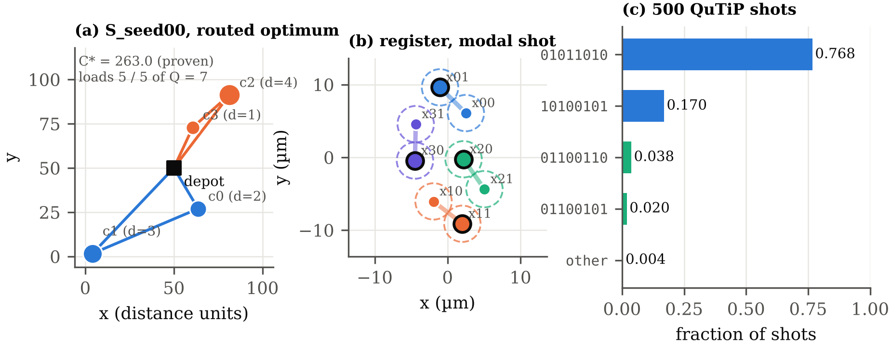
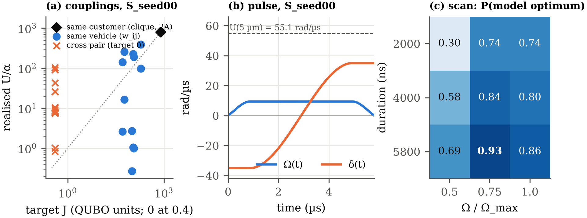
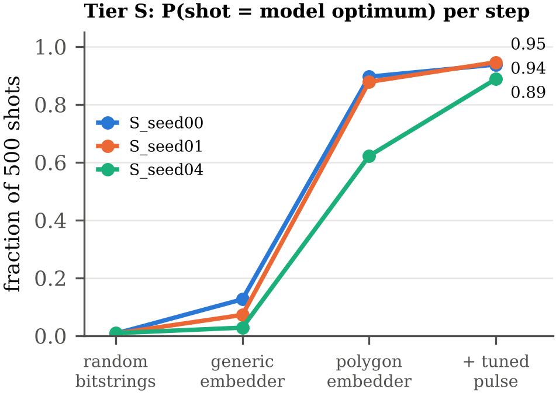
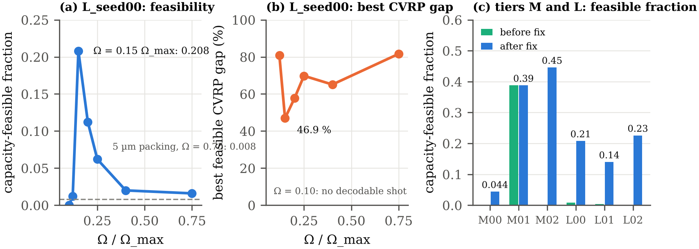
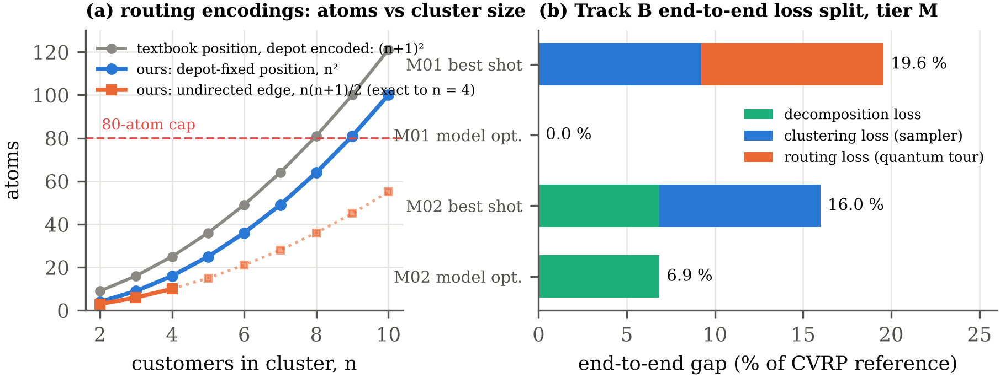

# Spending Fewer Atoms: Slack-Free One-Hot Clustering of the CVRP on an Analog Neutral-Atom Register

**Team Qualies — DuQuantum Hackathon, Pasqal challenge "Analog quantum devices for optimization problems" (brief v3.0, 24 Oct 2026).**
Track A (capacity-feasible clustering) is the primary submission; Track B (clustering + intra-cluster routing) is a complete, honestly-labelled supplementary slice.

**Submission documents**

| | |
|---|---|
| 📄 [**Report** (4 pages, PDF)](submission/report.pdf) | model, variable accounting, embedding, pulse design, results, what did not work — editable LaTeX in [`submission/report_src/`](submission/report_src/) |
| 📘 **README** (this file) | everything in the report, plus full tables, derivations and reproduction commands |

> One-command reproduction of the headline row:
> ```bash
> python -m pip install -r requirements.txt      # exact pins (Python 3.11+; hackathon venv is 3.14)
> python scripts/make.py demo                    # validate instances, assert device limits, run S_seed00 on
>                                                # pulser-simulation (QuTiP) + random sampler, 500 shots,
>                                                # write out/demo/*.json and out/demo/results_demo.csv
> ```
> The demo runs `python -m cvrp.run --instance instances/S_seed00.json --formulation onehot-ub --embedder polygons --backend qutip --shots 500 --seed 0` on the committed register in `embeddings/`. The register, the pulse and every classical number reproduce exactly; emulator sampling reproduces to sampling noise (TV ≈ 0.05 at 500 shots).

---

## Contents

1. [What we built and how each step improved it](#1-what-we-built-and-how-each-step-improved-it)
2. [The problem and the decomposition (Derive 2.1)](#2-the-problem-and-the-decomposition-derive-21)
3. [What the register minimises (Derive 3.1)](#3-what-the-register-minimises-derive-31)
4. [The clustering model: one-hot, no slack (Task A1)](#4-the-clustering-model-one-hot-no-slack-task-a1)
5. [Variable accounting (Derive 4.1)](#5-variable-accounting-derive-41)
6. [Instances, certificates and reference values (Task A2)](#6-instances-certificates-and-reference-values-task-a2)
7. [Embedding (Task A3)](#7-embedding-task-a3)
8. [Pulse shaping (Task A4)](#8-pulse-shaping-task-a4)
9. [Results in full (brief §9)](#9-results-in-full-brief-9)
10. [Track B: routing (Tasks B1–B3)](#10-track-b-routing-tasks-b1b3)
11. [What did not work](#11-what-did-not-work)
12. [Use of AI](#12-use-of-ai)
13. [Repository map and how to reproduce everything](#13-repository-map-and-how-to-reproduce-everything)
14. [Deliverable checklist (brief §10)](#14-deliverable-checklist-brief-10)

---

## 1. What we built and how each step improved it

**In one paragraph.** We encoded the capacity-feasible clustering of customers onto vehicles with one atom per (customer, vehicle) pair and **no slack atoms**: 8 / 30 / 60 atoms on tiers S / M / L, where the textbook slack encoding needs 14 / 45 / 80. The capacity inequality is handled by unbalanced penalization, which on valid (one-hot) strings collapses exactly to a load-balance coupling, so every coupling is positive and every linear term is equal — the model runs on one global detuning, with no DMM. We then built the pieces needed to make the register actually sample this model, and measured every change before and after. The result is a pipeline that returns the model-optimal clustering in **89–99 % of raw shots on every tier-S instance**, decodes **98–100 %** of shots on tier M, and produces capacity-feasible clusterings in **14–23 %** of shots on the 60-atom tier L.

**The improvement ladder.** Each row was measured on the same instances and committed registers before and after the change (raw shots, 500 per row, no repair). P(opt) is the fraction of shots that are the model-optimal clustering; values are per instance in the order listed.

| # | What we changed | Why | Measured on | Before → after |
|---|---|---|---|---|
| 1 | Textbook slack encoding → **one-hot + unbalanced penalization** (the one-hot identity drops every non-uniform linear term) | Slack bits cost atoms and give per-atom linear terms that a global detuning cannot realise | all tiers | Atoms 14/45/80 → **8/30/60**; linear terms non-uniform → **uniform** |
| 2 | Generic embedder → **rigid 5 µm polygons fitted on the one-hot subspace** | The "zero" cross-vehicle couplings came out as strong as the wanted ones | S_seed00/01/04 | Coupling error 0.95 → 0.21–0.32; P(opt) 0.13/0.07/0.03 → **0.90/0.88/0.62**; feasibility 0.22/0.09/0.06 → 0.99/0.88/0.99 |
| 3 | Pulse 4000 ns at $\Omega_{\max}$ → **5800 ns at** $\boldsymbol{0.75\,\Omega_{\max}}$ (from a scan) | Longer sweep; gentler drive on the 55 rad/µs clique couplings | S_seed00/01/04 | P(opt) 0.90/0.88/0.62 → **0.94/0.95/0.89**; feasibility 0.99/0.88/0.99 → 1.00/0.95/1.00 |
| 4 | **Enforce** $\boldsymbol{\delta_f < U_{\mathrm{clique}}}$ (derived bound) | The fit ran to 125.66 rad/µs, which rewards two excitations per triangle | M_seed00/02 | Decodable 0/0 → **0.99/1.00**; feasible 0/0 → 0.044/0.446 |
| 5 | **Bound from the weakest polygon pair** | A square's diagonal coupling is 8× weaker than its side | tier L | $\delta_f$ 35.8 → 4.5 rad/µs; the mis-set run was discarded before reporting |
| 6 | Polygon spacing **5 µm → 8 µm** | Caps spurious couplings at 3.3 rad/µs; defect gaps 1.1 → 2.4 rad/µs | L_seed00/01/02 | Optimum's one-hot rank on L_seed00: 16 534 → 1 795 |
| 7 | **Drive matched to the** $\boldsymbol{K = 4}$ **energy scale**, $\Omega$: $0.75 \to 0.15\,\Omega_{\max}$ | The whole one-hot landscape spans only a few rad/µs | L_seed00/01/02 | Feasible 0.008/0.004/0 → **0.208/0.140/0.226**; best CVRP gap 80/75/— → **47/40/36 %** |
| 8 | Bond dimension $\boldsymbol{\chi = 32 \to 64}$ | Convergence of the 30-atom emulation | M_seed01 | Best CVRP gap 9.2 → **5.9 %**; peak $\chi$ 14 (converged) |

**Best final row per tier** (brief Table 3 metrics; every gap on feasible decodes only):

| instance | atoms | feasibility | model gap | CVRP gap | P(reach $C^*$) | P(gap $\le$ 5 %) | fidelity full (subspace) | reference | emulation |
|---|---|---|---|---|---|---|---|---|---|
| S_seed00 | 8 | 1.00 | 0.0 % | 0.0 % | 0.94 | 0.94 | 0.26 (0.38) | proven | QuTiP, exact |
| S_seed02 | 8 | 1.00 | 0.0 % | 0.0 % | 0.99 | 0.99 | 0.31 (0.28) | proven | QuTiP, exact |
| M_seed01 | 30 | 0.39 | 33.8 % | 5.9 % | 0.00 | 0.00 | 0.08 (0.96) | best known | emu-mps $\chi = 64$ |
| L_seed02 | 60 | 0.23 | 47.1 % | 36.3 % | 0.00 | 0.00 | 0.51 (1.05) | best known | emu-mps $\chi = 32$ |

All quantum numbers are **raw shots**: no repair, no DMM, no post-selection other than discarding infeasible decodes (which never contribute a cost). Repair rows exist and are labelled separately (§9.6). Classical and random reference points requested by brief §9.2 are given in §9 as context.



*Figure 1. (a) S_seed00 with the proven-optimal clustering, routed exactly. (b) The 8-atom register: four 5 µm dimers, one per customer; bold atoms are excited in the modal shot `01011010`. (c) 500 QuTiP shots: both labelings of the optimal clustering (blue) are 93.8 % of shots; 99.8 % of shots are capacity-feasible.*

---

## 2. The problem and the decomposition (Derive 2.1)

**Sets and parameters.** Customers $C = \{0,\dots,N-1\}$ at locations $p_i \in [0,100]^2$ with integer demands $d_i \ge 1$, $d_i \le Q$; $K$ identical vehicles of capacity $Q$; a depot, fixed **before** clustering at the centre of the square, $(50, 50)$ (stated in every instance file as `depot_rule`); symmetric Euclidean costs $c_{uv}$ (triangle inequality holds).

**Decision variables (full CVRP).** Assignment $x_{ik} \in \{0,1\}$ (customer $i$ served by vehicle $k$) and routing arcs $y^k_{uv}$.

**Objective.** Minimise the total distance driven by the fleet.

**Constraints, marked by type.**

| # | constraint | type |
|---|---|---|
| 1 | every customer on exactly one vehicle: $\sum_k x_{ik} = 1 \;\; \forall i$ | **equality** |
| 2 | capacity: $\sum_i d_i x_{ik} \le Q \;\; \forall k$ | **inequality** |
| 3 | degree / flow: each customer has one incoming and one outgoing arc of its vehicle | equality |
| 4 | one trip per vehicle (unused vehicle allowed, costs nothing) | inequality |
| 5 | subtour elimination | inequality |

The asymmetry between 1 (one target value) and 2 (a range of allowed values) is the whole difficulty: an equality can be penalised as a squared deviation, an inequality cannot without a slack variable — or without one of the tricks in §4.

**Why cluster-first / route-second.** The direct (customer, vehicle, position) encoding needs $\sim N^2 K$ binaries: 32 / 300 / 900 on S / M / L against 80 atoms. Clustering alone needs $NK$ = 8 / 30 / 60 and each per-vehicle TSP is tiny (exact Held–Karp, `cvrp.common.route_exactly`). The price is the **decomposition gap** (brief Pitfall 2.1): the best clustering under our surrogate objective is not always the clustering of the shortest routes. We measure it on every instance (§9.5) rather than hide it.

---

## 3. What the register minimises (Derive 3.1)

Pulser's `AnalogDevice` evolves under

$$
\frac{H(t)}{\hbar} = \sum_i \frac{\Omega(t)}{2}\,\hat\sigma^x_i \;-\; \delta(t) \sum_i \hat n_i \;+\; \sum_{i<j} \frac{C_6}{\lVert \mathbf r_i - \mathbf r_j \rVert^6}\, \hat n_i \hat n_j , \qquad \hat n_i = \lvert r\rangle\langle r\rvert_i
$$

At the end of the pulse $\Omega = 0$, so $H$ is diagonal in the computational basis and a bitstring $x$ (1 = Rydberg) has the classical cost (in rad/µs)

$$
E_{\mathrm{dev}}(x) = -\delta_f \sum_i x_i \;+\; \sum_{i<j} \frac{C_6}{r_{ij}^6}\, x_i x_j
$$

This is a QUBO $E = \sum_i h_i x_i + \sum_{i<j} J_{ij} x_i x_j$ with three built-in restrictions:

| term | who controls it | what it means for us |
|---|---|---|
| $h_i = -\delta_f$, the same for every atom | **the laser** (final detuning, global, $\lvert\delta\rvert \le 125.66$ rad/µs; no DMM on `AnalogDevice`) | every variable must have the **same** linear coefficient |
| $J_{ij} = C_6 / r_{ij}^6 > 0$ | **the atom positions** ($r_{ij} \ge 5$ µm, register radius $\le 38$ µm) | every coupling is **positive**, bounded by $C_6/(5\,\mu\mathrm{m})^6 = 55.4$ rad/µs, never exactly zero, and must be a planar $1/r^6$ distance pattern |
| $C_6 = 8.657\times10^5$ rad/µs·µm⁶, the sign $+$ | **nobody** (fixed Rydberg physics) | the overall energy scale is set by distance only |

$\Omega$ and the duration ($\le 6000$ ns) set how adiabatic the sweep is, not the cost function. Everything below is an attempt to make the CVRP clustering look like $E_{\mathrm{dev}}$.

---

## 4. The clustering model: one-hot, no slack (Task A1)

Registry name: **`onehot-ub`** (`cvrp/formulations/onehot_ub.py`; derivation in `docs/MODEL.md` and `docs/DERIVATIONS.md` §4).

**Variables.** $x_{ik} = 1 \iff$ customer $i$ rides on vehicle $k$; QUBO index $i\cdot K + k$; $N\cdot K$ binaries and **nothing else**. A bitstring is *decodable* iff every customer's row has exactly one $1$; it is *feasible* iff it decodes **and** every load $L_k = \sum_i d_i x_{ik} \le Q$.

**Objective ("closeness").** Total pairwise distance inside each cluster,

$$
f(x) = \sum_k \sum_{i<j} d_{ij}\, x_{ik} x_{jk} .
$$

Why this one of the brief's options: it is a genuine quadratic with no centre variables, its couplings $d_{ij} \ge 0$ already have the device's sign, and it is **additive over clusters** — so an exact set-partition dynamic programme (`cvrp/exact.py`) certifies the model optimum on every tier. Known bias: it grows like $\lvert S\rvert^2$ for a cluster $S$, so it prefers small clusters and does part of the capacity constraint's work for free.

**Exactly-one (equality) → squared penalty.**

$$
A \sum_i \Big(1 - \sum_k x_{ik}\Big)^2 \;=\; A N \;-\; A \sum_{i,k} x_{ik} \;+\; 2A \sum_i \sum_{k<l} x_{ik} x_{il}
$$

i.e. a uniform linear term $-A$ on every variable and a coupling $+2A$ between the $K$ atoms of each customer (a $K$-clique per customer). No extra atoms.

**Capacity (inequality) → unbalanced penalization → the one-hot identity.** Write $g_k = Q - L_k \ge 0$ and penalise it with the two-term expansion of Montañez-Barrera, Willsch, Maldonado-Romo & Michielsen (Quantum Sci. Technol. 2024, arXiv:2211.13914): $\zeta(g) = -\lambda_1 g + \lambda_2 g^2$, no auxiliary variables. Expanding in the bits ($x^2 = x$):

$$
P_2(x) = \text{const} + \sum_i \sum_k c_i\, x_{ik} + 2\lambda_2 \sum_k \sum_{i<j} d_i d_j\, x_{ik} x_{jk}, \qquad c_i = d_i\,(\lambda_1 - 2\lambda_2 Q + \lambda_2 d_i)
$$

where $c_i$ depends on the customer, **not** on the vehicle.

**The one-hot identity:** on every string that satisfies exactly-one, $\sum_k x_{ik} = 1$, so $\sum_i \sum_k c_i x_{ik} = \sum_i c_i$ is a **constant**. The entire linear part of the capacity penalty — and with it $\lambda_1$, which appears nowhere else — is invisible where the model lives. We drop it. (Dropping it changes a string's energy by $\sum_i c_i \big(\sum_k x_{ik} - 1\big)$, zero on one-hot strings; it only re-shapes the landscape of strings that already violate exactly-one, which $A$ already pushes up.) What survives is, on one-hot strings,

$$
2\lambda_2 \sum_k \sum_{i<j} d_i d_j\, x_{ik} x_{jk} \;=\; \lambda_2 \sum_k L_k^2 + \text{const},
$$

a **load-balance term**. It is soft by design: for $K = 2$ the pure balance term has a feasible minimiser whenever a feasible split exists; adding the distance objective removes that guarantee, and for $K \ge 3$ there is none. Consequence (brief Pitfall 9.1): we score **feasible decodes only** and always report the feasibility rate.

**Final cost function.**

$$
E(x) = \sum_k \sum_{i<j} w_{ij}\, x_{ik} x_{jk} \;+\; A \sum_i \Big(1 - \sum_k x_{ik}\Big)^2, \qquad w_{ij} = d_{ij} + 2\lambda_2 d_i d_j
$$

| term | $h$ (diagonal) | $J$ (pair) | support |
|---|---|---|---|
| objective | $0$ | $+d_{ij}$ | same vehicle, $i < j$ |
| exactly-one | $-A$ on every variable | $+2A$ | same customer, $k < l$ |
| capacity → balance | $0$ (dropped, constant) | $+2\lambda_2 d_i d_j$ | same vehicle, $i < j$ |

Every coupling is positive ($d_{ij} \ge 0$, $2A > 0$, $2\lambda_2 d_i d_j > 0$) and every linear term is $-A$, so a single global final detuning $\delta_f = +\alpha A$ realises it. **No DMM is used anywhere in this submission.**

**Weights.**
* $A = \max_i \sum_{j\ne i} w_{ij} + 1$ (rule `row_sum`). Proof that every global minimiser is one-hot: for a customer with no vehicle, giving it one lowers the penalty by $A$ and raises the couplings by at most $\sum_{j\ne i} w_{ij} < A$; for a customer on $m \ge 2$ vehicles, removing one lowers the penalty from $A(m-1)^2$ to $A(m-2)^2$ and can only lower the couplings. Every repair step strictly lowers the energy, for every $\lambda_2$.
* $A = 1.01\, R_w/K$ (rule `row_sum_over_k`, formulation `onehot-ub-tight`): a factor $K$ smaller, also proved sufficient (a missing customer can always be added to the vehicle where it picks up at most $R_w/K$). Kept as an **ablation** (§9.2) because on the device the larger margin is load-bearing.
* $\lambda_2 = \kappa\, R/(2Q)$, $R = \max_i \sum_j d_{ij}$, $\boldsymbol{\kappa = 0.15}$, from a brute-force scan on 40 toy tier-S seeds (all 256 bitstrings each): 35/40 sound, 37/40 argmin feasible, 5/5 shipped S instances sound; $\kappa = 0$ is sound exactly where capacity does not bind; $\kappa = 1$ makes all 40 feasible but 13 suboptimal. No $\kappa$ is sound on all 40 — "closest" and "most balanced" conflict where capacity binds, and a soft term cannot force $L_k \le Q$.
* Brute-force checker (`python -m cvrp.model --formulation onehot-ub --instance …`, outputs in `docs/checks/`): on every shipped S instance the argmin is feasible and optimal, $A$ survives one halving and fails at $A/4$, $\lambda_2$ is not binding (`ok_at_zero = True`).

---

## 5. Variable accounting (Derive 4.1)

Generated by `python scripts/variable_count.py --write-md` (never typed). $B = \lceil \log_2(Q+1) \rceil$ slack bits per vehicle = 3 / 5 / 5.

| Encoding | count | S ($N{=}4, K{=}2, Q{=}7$) | M (10, 3, 20) | L (15, 4, 30) | fits in 80 atoms? |
|---|---|---|---|---|---|
| Assignment variables only, no constraints | $NK$ | 8 | 30 | 60 | yes / yes / yes |
| + binary-encoded slack (textbook) | $NK + KB$ | 14 | 45 | 80 | yes / yes / yes (L = cap) |
| **Ours (`onehot-ub`)** | $NK$ | **8** | **30** | **60** | **yes / yes / yes** |

We save 6 / 15 / 20 atoms (25 % of the budget on L) and never read out a bit whose value is discarded. The coupling support is the $N\times K$ rook's graph (S 16/28, M 165/435, L 510/1770 non-zero target pairs); the capacity term adds **no** new pairs, unlike the textbook's dense slack block.

The textbook formulation (`textbook`, one-hot + binary slack, $A = B_w = \sum_{i<j} d_{ij} + 1$, provably sound) was implemented only to exercise the plumbing. It is not device-realisable for two independent reasons: its linear terms $h(x_{ik}) = -A + B_w(d_i^2 - 2Q d_i)$ and $h(s_{kb}) = B_w(4^b - 2Q\cdot 2^b)$ vary by a factor $\sim 3$ across atoms, which a global detuning collapses to their mean (losing exactly the capacity bookkeeping), and the slack block couples every pair of a vehicle's $N + B$ variables — the dense all-to-all pattern a planar $1/r^6$ register handles worst.

---

## 6. Instances, certificates and reference values (Task A2)

**Generator** (`cvrp/instances.py`, version 1.0, `numpy.random.default_rng(seed)`): tiers from brief Table 1, depot $(50, 50)$, locations uniform in $[0,100]^2$ rounded to 2 decimals and pairwise distinct.

**Feasibility by construction — certificate first.** A customer→vehicle assignment is drawn *before* the demands (group sizes differ by at most one, every vehicle gets $\ge 1$ customer); demands are then drawn vehicle by vehicle, uniformly on $\big[d_{\min},\ \min(d_{\max},\ \text{capacity left} - d_{\min}\times\text{customers still to come})\big]$, so no vehicle can exceed $Q$. That assignment ships as `certificate`; `python -m cvrp.validator instances/` re-generates each instance from its seed, fails on any differing coordinate/demand/certificate entry, and re-checks the certificate (every customer once, all loads $\le Q$). Load ratios are kept away from 1 (`rho_min = 0.6`, never pushed to the point where the certificate is the only feasible clustering).

| instance | $\rho = \sum_i d_i/(KQ)$ | $d_{\max}/Q$ | $C^*$ | status | # optimal clusterings | vehicles used |
|---|---|---|---|---|---|---|
| S_seed00 | 0.714 | 0.571 | 262.97 | proven optimum | 1 | 2 |
| S_seed01 | 0.857 | 0.571 | 245.02 | proven optimum | 1 | 2 |
| S_seed02 | 0.714 | 0.429 | 254.62 | proven optimum | 1 | 2 |
| S_seed03 | 0.643 | 0.571 | 197.44 | proven optimum | 1 | 2 |
| S_seed04 | 0.714 | 0.571 | 184.42 | proven optimum | 1 | 2 |
| M_seed00 | 0.950 | 0.400 | 432.00 | best known | 1 | 3 |
| M_seed01 | 0.733 | 0.400 | 368.36 | best known | 1 | 3 |
| M_seed02 | 0.700 | 0.400 | 360.86 | best known | 1 | 3 |
| L_seed00 | 0.650 | 0.300 | 446.97 | best known | 1 | 3 of 4 |
| L_seed01 | 0.708 | 0.333 | 434.91 | best known | 1 | 3 of 4 |
| L_seed02 | 0.600 | 0.300 | 424.66 | best known | 1 | 3 of 4 |

**References (brief §9.3).** CPLEX is not installable in the hackathon venv (no wheel/licence), so $C^*$ is obtained by `scripts/reference_qubosolver.py` as the best of (2) `qubo-solver`'s classical solver on our penalized `onehot-ub` QUBO — its simulated annealing with stated parameters ($T_0$ = max penalty weight, $T_f = 10^{-3}\,T_0$, geometric cooling, 10 seeded restarts, **60 s max solve time**), every returned bitstring decoded, feasible decodes routed exactly — and (3) our constrained simulated annealing on the CVRP itself ($T_0 = 20$, $T_f = 0.01$, $\alpha = 0.995$ per sweep, $\le 50\,000$ moves, 10 restarts, seeds 0–9, same 60 s budget). Every setting is recorded in each instance's `reference.solver_settings`. On tier S the brief also demands brute force with an agreement check: the exhaustive set-partition DP × exact TSP (`cvrp/exact.py`) and a naive enumeration of all $K^N$ assignments agree 5/5, so **S references are proven optima**; M/L carry **best known**. (The exact DP returns the same 11 values; we label M/L best-known because that is the §9.3 route we chose.) Noteworthy: qubo-solver's SA on the 60-variable L QUBO stays 23–34 % above the constrained annealer within 60 s — the penalty landscape is a harder search space than the constrained problem, which is why $C^*$ is never the QUBO solver alone. All L optima use 3 of 4 vehicles (allowed by brief assumption 6; the model must not force exactly $K$ non-empty groups). Optimal clusterings are counted modulo vehicle relabelling (Pitfall 9.3).

**Model-gap reference.** The exact optimum of the constrained clustering model (`cvrp.exact`, all tiers; enumeration of all $K^N$ assignments on S/M), with the number of optima counted as sets of customer groups.

---

## 7. Embedding (Task A3)

### 7.1 Generic embedding and why it fails

`cvrp/embed.py` maps any sign-compatible QUBO to a register: target distances $r_{ij} = \left(C_6 / \alpha J_{ij}\right)^{1/6}$, $\alpha$ as large as the 5 µm floor allows (capped by $\lvert\delta_f\rvert \le 125.66$ rad/µs), multi-start L-BFGS on positions with hinges for the 5 µm floor and 38 µm radius, refuses any $J_{ij} < 0$, approximates $J_{ij} = 0$ by distance and reports the largest spurious coupling. Fidelity is reported as the brief asks, over all pairs $i \ne j$ (plus the worst pair and the largest spurious coupling):

$$
\text{rel\_frobenius\_offdiag} = \frac{\lVert U/\alpha - J \rVert_F}{\lVert J \rVert_F}
$$

On the rook's graph this fails exactly as the brief's §4 warns: the $K$ copies of a customer must sit 5 µm apart, so any atom of another customer is at nearly the same distance from all of them and the "zero" cross-vehicle couplings come out as strong as the wanted ones. Measured on tier S: relative error **0.95**, P(reach model optimum) 3–13 %, and on S_seed04 the realised register's own ground state was an **infeasible** string.

### 7.2 Structure-aware embedding: ask the register for less

The model only lives on one-hot strings, where each customer pair contributes exactly one coupling. Writing the device energy on one-hot strings, with $a_i$ the vehicle of customer $i$,

$$
E_{\mathrm{dev}}(a) = -\delta_f N + \sum_{i<j} U(i,a_i;\, j,a_j),
$$

only the **effective** coupling

$$
U_{\mathrm{eff}}(i,j) = U(i,k;\, j,k) - \operatorname*{mean}_{l\ne k}\, U(i,k;\, j,l)
$$

must equal $\alpha\, w_{ij}$; the cross couplings need not vanish, only be (nearly) constant on the subspace. `cvrp/embed_onehot.py` therefore:

1. makes each customer a **rigid regular $K$-gon of side 5 µm** (dimer for $K = 2$, triangle for $K = 3$, square for $K = 4$), so the exactly-one clique $2A$ is realised *exactly* with $\alpha = C_6 / \big((5\,\mu\mathrm{m})^6 \cdot 2A\big)$ at the minimum separation;
2. optimises the polygon centres and orientations (L-BFGS, 6 seeded starts) so that the device energies of all $K^N$ one-hot strings (all of them up to 4096, else a seeded sample of 2048) fit $\alpha\, E_{\mathrm{QUBO}}$ up to a constant — normalised residual, slope fixed at $\alpha$;
3. forces every **single-flip defect** (a customer with 0 or 2 atoms excited) at least half the model's penalty gap above its parent one-hot string;
4. keeps atoms of different polygons $\ge 5$ µm apart ($\ge 8$ µm with `polygons-cross8`, §9.4) and the register inside 38 µm;
5. fits $\boldsymbol{\delta_f}$ as a free parameter: on the one-hot subspace it is a constant, so it only sets the defect gaps; it starts at $\alpha A$ (27.5 rad/µs) and lands at 35–38 rad/µs on S.

Every run record reports (i) the brief's full-matrix fidelity, (ii) the subspace fidelity, energy-fit residual, cross-coupling anisotropy and same-vehicle asymmetry, and (iii) the **realised-register check**: is the device's own argmin feasible and the model optimum, at which device-energy rank the model optimum sits, and the smallest single-flip defect gap. Read (iii) first.

**Before / after on tier S** (committed registers, baseline pulse 4000 ns at $\Omega_{\max}$, QuTiP, 500 shots): P(reach model optimum) 13 / 7 / 3 % → **90 / 88 / 62 %** (generic → polygons, S_seed00/01/04), feasibility 22 / 9 / 6 % → **99 / 88 / 99 %**, realised argmin = model optimum on 3/3. With the tuned pulse (§8): 0.94 / 0.95 / 0.89.

Registers are seeded but not bit-identical across platforms (one seed gave $\delta_f = 32.8$ vs $35.1$ rad/µs and P(reach) 51 % vs 90 %), so **every reported row uses a cached, committed register** in `embeddings/`, loaded by name; a run whose register differs from the cache is re-run, not reported.



*Figure 2. (a) Target vs realised couplings on S_seed00 by pair class — cliques exact, same-vehicle approximate, cross pairs large but nearly constant on the one-hot subspace. (b) The committed pulse. (c) The duration × amplitude scan.*

### 7.3 The $\delta_f < U_{\min}$ bound (found on tier M)

Inside an isolated $K$-gon the energies at $\Omega = 0$ are

$$
E_0 = 0, \qquad E_1 = -\delta_f, \qquad E_2 = -2\delta_f + U_{\min}, \;\dots
$$

so one excitation is the clique ground state **only if**

$$
0 < \delta_f < U_{\min},
$$

with $U_{\min}$ the coupling of the *weakest* intra-polygon pair. For $K \le 3$ every chord is the 5 µm side, $U_{\min} = 55.1$ rad/µs. For $K = 4$ a square has diagonals at $5\sqrt2 = 7.07$ µm and $1/r^6$ turns $\sqrt2$ into a factor $(\sqrt2)^6 = 8$: $U_{\min} = 6.9$ rad/µs (four points in a plane are never equidistant, so a planar one-hot clique for $K \ge 4$ is never uniform). The tier-S fits land at $0.64$–$0.68\,U$; the ill-conditioned tier-M fit ran to the device maximum $125.66 = 2.28\,U$, which favours *two* excitations per triangle and gave **0 of 500 decodable shots**. The embedder now enforces the bound (fallback $0.65\,U_{\min}$; `scripts/fix_cached_delta.py` migrates cached registers with unchanged geometry). The first tier-L run was launched with the triangle bound ($\delta_f = 35.8 \gg 6.9$) and was discarded before reporting. This condition is necessary for an isolated polygon, not sufficient for the full register (occupied atoms of other polygons also enter the excitation cost).

---

## 8. Pulse shaping (Task A4)

**Shape** (`cvrp/pulse.py`, brief §8.2 baseline): a three-point $\Omega$ ramp ($0 \to \Omega$ at 15 % of $T$, plateau to 85 %, $\to 0$ at $T$) and a linear $\delta$ sweep during the plateau from $\delta_{\mathrm{init}} = -\min\!\big(\max(\lvert\delta_f\rvert,\, 2\Omega_{\max}),\, \delta_{\max}\big)$ to the fitted $\delta_f$, both as Pulser `InterpolatedWaveform`s (PCHIP, monotone, never overshooting the limits). Starting far below resonance prepares $\lvert g\cdots g\rangle$; the positive end point favours one excitation per customer, and the repulsive couplings decide which. Every sequence is built with `pulser.Sequence` on `AnalogDevice`, serialised with `to_abstract_repr()`, its duration asserted, and the sampled waveforms and register re-validated against the device object (limits are read from the device, never hard-coded). An optional slow-region knob inserts extra $\delta$-knots to slow the sweep over part of the detuning path at fixed total duration.

**Scan** (`scripts/scan.py`, three S instances, structure-aware registers, in-house exact state-vector emulator, 500 shots; scored by P(reach), best gap and feasibility, never mean cost):

| $T$ (ns) \ $\Omega/\Omega_{\max}$ | 0.5 | 0.75 | 1.0 |
|---|---|---|---|
| 2000 | 0.305 | 0.740 | 0.739 |
| 4000 | 0.579 | 0.844 | 0.797 |
| 5800 | 0.695 | **0.932** | 0.865 |

Longer is monotonically better at every $\Omega$ (adiabatic theorem at fixed gap); $0.75\,\Omega_{\max}$ beats full power at 4000 and 5800 ns because the plateau $\Omega = 9.4$ rad/µs sits closer to the same-vehicle couplings (3–13 rad/µs) while dressing the 55 rad/µs cliques less; $\Omega_{\max}/2$ is too weak to open the gap. $\delta_f \times \{0.8, 1, 1.25\}$ gives 0.915 / 0.932 / 0.884, so the fitted value stands. A slow region in the last part of the sweep gains +2.5 pp (0.932 → 0.959) — at the edge of sampling noise, so the committed default is the plain linear sweep. **Committed:** $\boldsymbol{T = 5800}$ **ns** (device max − 200 ns margin), $\boldsymbol{\Omega = 0.75\,\Omega_{\max}}$, **fitted** $\boldsymbol{\delta_f}$. S_seed02/03, not in the scan, reach the model optimum in 99 % / 96 % of shots. qubo-solver's own drive shaper independently lands in the same corner (5940 ns, $\Omega = 9.7$–$10.1$ rad/µs), which is reassuring but was not used to pick ours.

**Tier L drive.** With $\delta_f < 6.9$ rad/µs the whole one-hot landscape of a 60-atom register is compressed into a few rad/µs (single-flip defect gaps 1.1–2.4 rad/µs vs 19–23 on M). The S pulse ($\Omega = 9.4$ rad/µs, sweep rate $\approx 7$ rad/µs²) is far from adiabatic on that scale and 98.6 % of shots leave the one-hot manifold. Scaling the drive to the landscape — $\boldsymbol{\Omega = 0.15\,\Omega_{\max} = 1.9}$ **rad/µs** — is a sharp optimum (§9.4).

**Emulators.** pulser-simulation (QuTiP) for every S headline row; emu-sv cross-check (S_seed00: 0.96 vs 0.94); an in-house exact state-vector integrator (`cvrp/svsim.py`) built from Pulser's own per-ns samples, used for the scans (TV distance 0.05–0.07 from QuTiP at 500 shots, i.e. sampling noise); emu-mps for M and L with $\mathrm{d}t = 10$ ns, precision $10^{-5}$, bond dimension $\chi$ and the **peak** bond dimension actually reached recorded on every row. M_seed00 peaks at $\chi = 12$ under caps of 32 and 64 (converged: the $\chi = 32$/$64$ differences are sampling noise), M_seed02 at $\chi = 7$; M_seed01 was re-run at $\chi = 64$ (peak 14, converged); the L rows are run at $\chi = 32$ with the peak $\chi$ (17–32) recorded on every record.

---

## 9. Results in full (brief §9)

Metrics per (instance, method, seed), as in brief Table 3: atoms; feasibility rate (fraction of shots that decode **and** satisfy capacity); best model gap (best feasible shot vs the exact model optimum); best CVRP gap (that shot's clustering routed exactly vs $C^*$); P(reach $C^*$) (fraction of shots whose clustering routes to $C^*$, so it includes the decomposition loss); P(reach model optimum); P(model gap $\le \varepsilon$) for $\varepsilon \in \{0, 1, 5, 10\}$ % (we quote $\varepsilon = 5$ %); embedding fidelity (full-matrix and one-hot-subspace); reference status; backend, $\chi$, peak $\chi$, DMM (never used), repair label. Gaps are undefined when no shot is feasible, and reported as such. Clusterings are compared as sets of customer groups. 95 % Wilson intervals are in `results.csv`.

### 9.1 Tier S (8 atoms, pulser-simulation/QuTiP, 500 shots, committed registers and pulse)

| instance | method | feas. | model gap | CVRP gap | P(reach $C^*$) | P(gap $\le$ 5 %) | fidelity full (subspace) |
|---|---|---|---|---|---|---|---|
| S_seed00 | **ours** | 1.00 | 0.0 % | 0.0 % | **0.94** | 0.94 | 0.26 (0.38) |
| S_seed00 | ours, tight $A$ (ablation) | 1.00 | 0.0 % | 0.0 % | 0.03 | 0.03 | 0.31 |
| S_seed00 | ours, generic embedder (before) | 0.22 | 0.0 % | 0.0 % | 0.13 | 0.13 | 0.95 |
| S_seed00 | random one-hot assignments | 0.63 | 0.0 % | 0.0 % | 0.12 | 0.12 | — |
| S_seed00 | qubo-solver quantum (BLaDE + its drive, emu) | 1.00 | 0.0 % | 0.0 % | 0.78 | 0.78 | 0.12 |
| S_seed00 | qubo-solver tabu (classical) | 1.00 | 0.0 % | 0.0 % | 1.00 | 1.00 | — |
| S_seed00 | uniform random bitstrings | 0.04 | 0.0 % | 0.0 % | 0.01 | 0.01 | — |
| S_seed01 | **ours** | 0.95 | 0.0 % | 0.0 % | **0.95** | 0.95 | 0.21 (0.57) |
| S_seed02 | **ours** | 1.00 | 0.0 % | 0.0 % | **0.99** | 0.99 | 0.31 (0.28) |
| S_seed03 | **ours** | 1.00 | 0.0 % | 15.6 % | 0.01 | **0.96** | 0.29 (0.26) |
| S_seed04 | **ours** | 1.00 | 0.0 % | 21.7 % | 0.02 | **0.89** | 0.32 (0.25) |

Reading. After the embedding and pulse improvements (ladder steps 2–3), the register returns the model-optimal, capacity-feasible clustering in 89–99 % of raw shots on all five instances. On S_seed03/04 the model gap is 0 % while the CVRP gap is 15.6 / 21.7 %: this is the **decomposition gap** (the closest clustering is not the shortest-route clustering), so the register did its job and the surrogate objective is what loses. On every S instance P(gap $\le$ 5 %) = P(model optimum) because the next-best feasible clustering is 11–62 % worse. qubo-solver's full analog pipeline, scored identically, gives P(reach model optimum) = 0.78 / 0.78 / 0.18 / 0.79 / 0.00 (P(reach C*) = 0.78 / 0.78 / 0.18 / 0.18 / 0.002; a 27 % model gap on S_seed04).

**Reference points (brief §9.2).** For context, the same decoder and scorer applied to uniformly random valid assignments give P(reach model optimum) = 2/16 = 0.125 on every S instance (feasibility 25–63 %), and to uniform random bitstrings 0.7–1.2 %.



*Figure 3. Tier S, step by step (QuTiP, 500 shots per point): random bitstrings → generic embedder → polygon embedder → tuned pulse. The structure-aware embedder is the largest single gain; the pulse scan closes most of the remaining gap, most of all on S_seed04.*

### 9.2 Ablations on tier S

* **Tight exactly-one weight** $A = R_w/K$ (`onehot-ub-tight`): provably sound, checker-verified, same register construction and pulse — P(reach optimum) 0.94 → 0.03 (S_seed00), 0.95 → 0.52 (S_seed01), 0.89 → 0.94 (S_seed04). $A$ sets the single-flip defect gaps in device units and the margin the embedding error can eat; the tight value leaves none on two of three seeds. The large provable $A$ is physically load-bearing.
* **Weight scan** ($A \times \{0.5, 0.75, 1, 1.5\}$, $\lambda_2 \times \{0.5, 1, 2\}$, embedding recomputed per point): no monotone trend — the embedding optimiser lands on a different local minimum for every setting and that moves P(reach) more than a factor 2 on either weight. Weights stay as derived.
* **Capacity weight, held out** (`out/two_hour/capacity/`): from seeds 1000–1199 the first eight S instances whose *unconstrained* distance optima all overload a vehicle; $\kappa = 0.6$ selected on four development cases (frozen before the four held-out cases were inspected). Held out, $\kappa = 0.15 \to 0.6$: feasibility 0.03 → 1.00, 0.85 → 0.19, 0.04 → 1.00, 1.00 → 1.00 (mean 0.48 → 0.80); P(reach $C^*$) 0.00 → 0.05, 0.84 → 0.01, 0.00 → 0.00, 0.70 → 0.71 (mean 0.39 → 0.19). A stronger balance term buys feasibility and pays with optimality, instance by instance; it remains an ablation, not the default.

### 9.3 Tier M (30 atoms, emu-mps, 500 shots)

| instance | method | decodable | feas. | model gap | CVRP gap | P(reach $C^*$) | fidelity full (subspace) | $\chi$ (peak) |
|---|---|---|---|---|---|---|---|---|
| M_seed00 | ours, $\delta_f$ unbounded (before) | 0.00 | 0.00 | undefined | undefined | 0.00 | 0.58 (1.55) | 32 (32) |
| M_seed00 | **ours, $\delta_f = 0.65\,U_{\mathrm{clique}}$** | 0.99 | 0.044 | 67.9 % | 29.9 % | 0.00 | 0.58 (1.55) | 32 (12) |
| M_seed00 | ours, $\chi = 64$ | 1.00 | 0.030 | 70.2 % | 30.7 % | 0.00 | 0.58 (1.55) | 64 (12) |
| M_seed00 | qubo-solver quantum | 0.99 | 0.016 | 72.1 % | 35.2 % | 0.00 | 0.09 | 32 |
| M_seed01 | **ours** | 0.98 | 0.388 | 37.9 % | 9.2 % | 0.00 | 0.08 (0.96) | 32 (32) |
| M_seed01 | **ours, $\chi = 64$** | 1.00 | 0.388 | 33.8 % | **5.9 %** | 0.00 | 0.08 (0.96) | 64 (14) |
| M_seed01 | qubo-solver quantum | 1.00 | 0.37 | 47.5 % | 11.2 % | 0.00 | 0.08 | 32 |
| M_seed01 | qubo-solver tabu (classical) | 1 | 1 | 65.4 % | 17.6 % | 0 | — | — |
| M_seed02 | ours, $\delta_f$ unbounded (before) | 0.00 | 0.00 | undefined | undefined | 0.00 | 0.47 (1.42) | 32 (16) |
| M_seed02 | **ours, $\delta_f = 0.65\,U_{\mathrm{clique}}$** | 1.00 | 0.446 | 23.0 % | 16.0 % | 0.00 | 0.47 (1.42) | 32 (7) |
| M_seed02 | qubo-solver quantum | 0.99 | 0.39 | 34.2 % | 13.6 % | 0.00 | 0.09 | 32 |
| M_seed02 | qubo-solver tabu (classical) | 1 | 1 | 10.2 % | 2.8 % | 0 | — | — |
| M (all) | uniform random bitstrings, 2000 shots | 0 | 0 | undefined | undefined | 0 | — | — |

Where the loss is (`scripts/landscapes.py`, all $3^{10} = 59\,049$ one-hot strings enumerated, `docs/checks/landscapes.md`):
* **Penalty:** on M_seed00/01 the QUBO argmin over one-hot strings *is* the model optimum; on M_seed02 it is a feasible clustering 10.2 % above it (the model optimum sits at QUBO rank 331) — exactly where qubo-solver's tabu lands. So on M_seed02, 10 of the 23 points of model gap are the $\lambda_2$ rule.
* **Register:** the model optimum sits at realised-device rank 10 474 / 12 966 / 4 192 — **this is where most of the loss is.** The constraints embed (98–100 % one-hot), the distance ordering does not.
* **Pulse:** the sampled best feasible shots (67.9 / 37.9 / 23.0 % model gap) are *better* than the register's own best feasible one-hot string under $E_{\mathrm{dev}}$ (82.0 / 101.3 / 93.9 %), so the sweep is not the bottleneck.

qubo-solver's independent pipeline lands in the same regime, which supports reading this as a property of one-hot CVRP clustering on a planar $1/r^6$ register at $K = 3$, not of our embedder.

### 9.4 Tier L (60 atoms, $K = 4$, emu-mps $\chi = 32$, 500 shots) — the geometry result

| instance | geometry / drive | decodable | feas. | model gap | CVRP gap | one-hot rank of optimum | defect gap (rad/µs) | peak $\chi$ |
|---|---|---|---|---|---|---|---|---|
| L_seed00 | 5 µm packing, $\Omega = 0.75\,\Omega_{\max}$ | 0.014 | 0.008 | 140.0 % | 79.7 % | 16 534 | 1.10 | 32 |
| L_seed00 | 8 µm spacing, $\Omega = 0.75\,\Omega_{\max}$ | 0.024 | 0.016 | 122.1 % | 81.6 % | 1 795 | 2.42 | 26 |
| L_seed00 | 8 µm, $\Omega = 0.10\,\Omega_{\max}$ | 0.000 | 0.000 | undefined | undefined | 1 795 | 2.42 | 32 |
| L_seed00 | 8 µm, $\Omega = 0.12\,\Omega_{\max}$ | 0.034 | 0.012 | 126.8 % | 80.9 % | 1 795 | 2.42 | 32 |
| L_seed00 | **8 µm, $\Omega = 0.15\,\Omega_{\max}$** | 0.402 | **0.208** | 64.4 % | **46.9 %** | 1 795 | 2.42 | 32 |
| L_seed00 | 8 µm, $\Omega = 0.20\,\Omega_{\max}$ | 0.202 | 0.112 | 99.4 % | 57.7 % | 1 795 | 2.42 | 32 |
| L_seed00 | 8 µm, $\Omega = 0.25\,\Omega_{\max}$ | 0.112 | 0.062 | 103.9 % | 69.8 % | 1 795 | 2.42 | 20 |
| L_seed00 | 8 µm, $\Omega = 0.40\,\Omega_{\max}$ | 0.042 | 0.020 | 120.6 % | 65.1 % | 1 795 | 2.42 | 32 |
| L_seed01 | 5 µm packing, $\Omega = 0.75\,\Omega_{\max}$ | 0.004 | 0.004 | 182.9 % | 75.1 % | 1 063 | 1.10 | 32 |
| L_seed01 | **8 µm, $\Omega = 0.15\,\Omega_{\max}$** | 0.410 | **0.140** | 59.8 % | **40.4 %** | 6 742 | 2.42 | 17 |
| L_seed01 | 8 µm, $\Omega = 0.25\,\Omega_{\max}$ | 0.104 | 0.034 | 128.6 % | 81.2 % | 6 742 | 2.42 | 10 |
| L_seed02 | 5 µm packing, $\Omega = 0.75\,\Omega_{\max}$ | 0.004 | 0.000 | undefined | undefined | 14 862 | 1.79 | 32 |
| L_seed02 | **8 µm, $\Omega = 0.15\,\Omega_{\max}$** | 0.374 | **0.226** | 47.1 % | **36.3 %** | 14 853 | 2.42 | 21 |
| L_seed02 | 8 µm, $\Omega = 0.25\,\Omega_{\max}$ | 0.110 | 0.076 | 92.6 % | 60.5 % | 14 853 | 2.42 | 32 |
| L (all) | qubo-solver tabu on the same QUBO | 1 | 1 | 58.9 / 70.3 / 59.1 % | 45.0 / 47.0 / 41.2 % | — | — | — |

All rows use $\delta_f = 4.475$ rad/µs $= 0.65\,U_{\min}$ (square diagonal bound). Raising the inter-polygon spacing to 8 µm caps every spurious cross-polygon coupling at $C_6/(8\,\mu\mathrm{m})^6 = 3.3$ rad/µs and doubles the defect gaps; matching the drive to that energy scale ($\Omega = 0.15\,\Omega_{\max} = 1.9$ rad/µs $\approx$ the 2.4 rad/µs defect gap) is a sharp optimum ($\Omega = 0.10\,\Omega_{\max}$ produces no decodable shot at all, $\Omega \ge 0.25\,\Omega_{\max}$ falls off again). Together they take feasibility from $\le 0.8$ % to **14–23 %** and the best CVRP gap from $\ge 75$ % to **36–47 %**, level with qubo-solver's tabu search on the same 60-variable QUBO — with 37–41 % of shots one-hot and 500 distinct bitstrings per run. The device now resolves the $K = 4$ landscape; the remaining loss is the one-hot ordering (model optimum at rank 1 795–14 853 of the realised one-hot energies), the same $K \ge 3$ geometry seen on M. Emulation parameters: emu-mps $\chi = 32$, $\mathrm{d}t = 10$ ns, precision $10^{-5}$, peak $\chi$ 17–32 recorded per record. These are the tier-L headline rows; they post-date the 79-row `results.csv` and live in `out/m_tier/L_*cross8*`, and the 8 µm registers are committed in `embeddings/` (`polygons-cross8`).



### 9.5 Decomposition gap and model selection (classical)

| instance | $C^*$ | model optimum routed exactly | decomposition gap | medoid objective | depot-MST objective |
|---|---|---|---|---|---|
| S_seed00 | 262.97 | 262.97 | 0.0 % | 6.4 % | 0.0 % |
| S_seed01 | 245.02 | 245.02 | 0.0 % | 0.0 % | 0.0 % |
| S_seed02 | 254.62 | 254.62 | 0.0 % | 3.1 % | 0.0 % |
| S_seed03 | 197.44 | 228.34 | 15.6 % | 0.0 % | 0.0 % |
| S_seed04 | 184.42 | 224.49 | 21.7 % | 17.3 % | 17.3 % |
| M_seed00 | 432.00 | 432.00 | 0.0 % | 0.0 % | 4.4 % |
| M_seed01 | 368.36 | 368.36 | 0.0 % | 0.0 % | 2.6 % |
| M_seed02 | 360.86 | 385.62 | 6.9 % | 6.9 % | 7.4 % |
| L_seed00 | 446.97 | 525.71 | 17.6 % | 15.6 % | **0.0 %** |
| L_seed01 | 434.91 | 470.67 | 8.2 % | 19.8 % | **0.0 %** |
| L_seed02 | 424.66 | 480.17 | 13.1 % | 19.8 % | **7.5 %** |

Each additive surrogate is solved exactly with capacity enforced (`out/two_hour/models/`) and its groups routed exactly; these are classical model-selection numbers, and the alternatives have not been mapped to the register. The depot-aware objective $\mathrm{MST}(S) + 2 \min_{i\in S} d_{0i}$ removes the pairwise objective's L loss on two of three instances but worsens every M instance — a promising L-specific objective, not a universal replacement.

### 9.6 Classical post-processing (labelled, never the headline)

A bounded capacity-local repair (relocations and pair swaps that strictly reduce overload, then capacity-preserving moves that strictly shorten the exactly routed distance, $\le 2N$ accepted moves, no reference data used) makes 98–100 % of M shots feasible and can reach a 0 % route gap — but identically processed random one-hot samples (seeds 0, 1, 2, matched shot budget) gain exactly the same (`out/two_hour/repair/comparison.csv`). Repaired rows therefore support no quantum claim and stay separate from every raw metric. An earlier single-flip "energy-descent" repair on the generic embedder is likewise labelled `repair=energy-descent` in `results.csv`.

---

## 10. Track B: routing (Tasks B1–B3)

Code: `routing/` (`encodings.py`, `check.py`, `fixtures.py`, `pilot.py`, `solve_cluster.py`), `scripts/routing_demo.py`, `scripts/routing_integrate.py`, 20 tests. Full write-up: `docs/ROUTING.md`. Emulation only (`cvrp.svsim`, exact state vector); nothing ran on hardware.

### B1 — the TSP for one cluster

A cluster is $n$ customers plus the depot (local index 0). Binaries $y_{i,t} = 1$ if customer $i$ is visited at position $t$. Objective and constraints (both **equalities**):

$$
\min \sum_{t=1}^{n-1} \sum_{i\ne j} c_{ij}\, y_{i,t}\, y_{j,t+1} \;+\; \text{(two depot legs)}, \qquad \sum_t y_{i,t} = 1 \;\; \forall i, \qquad \sum_i y_{i,t} = 1 \;\; \forall t .
$$

The device needs, as in Track A, uniform $h$ and $J \ge 0$.

### B2 — two encodings with fewer variables

| encoding | bits | $h$ | $J$ | exact? |
|---|---|---|---|---|
| textbook position, depot encoded | $(n+1)^2$ | non-uniform (depot legs are linear terms) | $\ge 0$ | yes |
| **depot-fixed position** | $\boldsymbol{n^2}$ | uniform $-2A$ | $\ge 0$ | yes, all $n$ |
| **undirected edge** | $\boldsymbol{n(n+1)/2}$ | uniform $-6A$ | $\ge 0$ | **only** $\boldsymbol{n \le 4}$ |

*Depot-fixed position.* The depot gets no variables; its two legs are folded into the first and last transition weights,

$$
w(i,j,t) = c_{ij} + [t=1]\, c_{0i} + [t=n-1]\, c_{j0},
$$

so the energy equals the full depot-to-depot tour length on every permutation (exact, not approximate; it changes only the energies of invalid strings) and the one-hot penalties give every variable the same $h = -2A$. Saves $2n+1$ bits.

*Undirected edge.* One bit $x_e$ per edge of the complete graph on $n+1$ vertices, with degree $d_v = \sum_{e \ni v} x_e$. The cost is spread over the two endpoints of each edge so that the linear terms stay uniform:

$$
E = \sum_v \sum_{\{e,f\} \ni v} \frac{c_e + c_f}{2}\, x_e x_f \;+\; A \sum_v (d_v - 2)^2 .
$$

The first term equals the tour length on every degree-2 string; $h_e = -6A$ for every edge, $J_{ef} = 2A + (c_e + c_f)/2$ for edges sharing a vertex and $0$ otherwise. For $n \ge 5$ two disjoint triangles are a degree-2 configuration that can be cheaper than every tour (fixture `tri5_subtour`: ground energy 6.0 vs best tour 203.0), so the builder refuses $n > 4$.

$A = 1.01\, C_{\mathrm{NN}}$ (nearest-neighbour tour cost) is proved sufficient without knowing the optimum. **Exhaustive checks** on 18 (encoding, $n \in \{2,3,4\}$, seed) cases: energy = tour cost on every permutation ($\lvert\text{error}\rvert < 10^{-7}$), ground energy = exact TSP, ground-state set = optimal tours, every infeasible string above $C_{\mathrm{opt}}$.

**Embeddability** (generic `cvrp.embed`, 6 seeds × 8 starts selected by fidelity): edge model = line graph of $K_5$ — relative Frobenius error 0.78–0.79, a $J = 0$ pair receiving up to 217 QUBO units against wanted $2A = 321$; position model — 0.98–0.99. Under the realised zero-drive device energies the optimal tour ranks 129–146 of 1024 (edge) and 429–668 of 65 536 (position); the device argmin never decodes to a tour.

### B3 — closing the loop

Policy (`routing/solve_cluster.py`): $n \le 3$ trivial → exact; $n = 4$ → both encodings (10 / 16 atoms, S pulse, 1000 shots each), best raw valid shot returned, else exact classical fallback, labelled with its reason; $n \ge 5$ → exact classical, labelled. Inputs: the best feasible emu-mps shot and the exact model optimum of M_seed01 and M_seed02.

| source | clusters | $C_{\mathrm{ref}}$ | $C_{\mathrm{dec}}$ | $C_{\mathrm{clust}}$ | $C_{\mathrm{end}}$ | decomposition | clustering | routing | **end-to-end gap** | trivial | quantum attempts | raw quantum routes | classical fallbacks |
|---|---|---|---|---|---|---|---|---|---|---|---|---|---|
| M_seed01 / best shot | [2,7,9] [3,4,5] [0,1,6,8] | 368.36 | 368.36 | 402.37 | 440.47 | 0.0 | +34.0 (9.2 %) | +38.1 (10.3 %) | **19.6 %** | 2 | 1 | 1 | 0 |
| M_seed01 / model optimum | [0,1,6] [3,4,5] [2,7,8,9] | 368.36 | 368.36 | 368.36 | 368.36 | 0.0 | 0.0 | 0.0 | **0.0 %** | 2 | 1 | 0 | 1 |
| M_seed02 / best shot | [0,5,9] [1,3,8] [2,4,6,7] | 360.86 | 385.62 | 418.59 | 418.59 | +24.8 (6.9 %) | +33.0 (9.1 %) | 0.0 | **16.0 %** | 2 | 1 | 0 | 1 |
| M_seed02 / model optimum | [1,8] [0,3,5,9] [2,4,6,7] | 360.86 | 385.62 | 385.62 | 385.62 | +24.8 (6.9 %) | 0.0 | 0.0 | **6.9 %** | 1 | 2 | 0 | 2 |

The identity

$$
C_{\mathrm{end}} - C_{\mathrm{ref}} = \underbrace{(C_{\mathrm{dec}} - C_{\mathrm{ref}})}_{\text{decomposition}} + \underbrace{(C_{\mathrm{clust}} - C_{\mathrm{dec}})}_{\text{clustering}} + \underbrace{(C_{\mathrm{end}} - C_{\mathrm{clust}})}_{\text{routing}}
$$

holds to $< 10^{-9}$ on every row. Totals: 12 clusters routed, 7 trivial, 5 quantum attempts on four distinct $n = 4$ clusters, **1 raw valid quantum tour** (edge encoding, `depot→0→6→8→1→depot`, 224.48 vs exact 186.38: **routing gap 20.4 %**), 0 optimal, 4 labelled classical fallbacks, 0 clusters with $n \ge 5$; fraction of non-trivial clusters routed quantumly 1/5; 10 000 quantum shots in total. Raw valid-tour probability: 1/4000 (edge), 0/4000 (position) — below a uniform random valid tour (100 % valid, P(opt) $= 1/12$). **No routing advantage is claimed**; the lever is a structure-aware routing register (as `embed_onehot` is for Track A), not pulse tuning.



---

## 11. What did not work

One honest line each; the full log is `docs/DID_NOT_WORK.md`.

1. **Generic embedding of the one-hot rook's graph** — error 0.95, P(reach) 3–13 %, an infeasible physical ground state on S_seed04. Fixed on $K = 2$ by the one-hot-subspace fit; not fixable on $K \ge 3$ by any tested planar register.
2. **One-hot does not embed at** $\boldsymbol{K = 3}$ — fit residual 38 (S: 0.06–0.32), defects below parents, optimum at one-hot rank ~10 000; opening the triangles to 6–10 µm lowers the energy scale without fixing the ordering.
3. **Unbounded** $\boldsymbol{\delta_f}$ **on tier M** — the fit ran to 125.66 rad/µs $= 2.28\,U_{\mathrm{clique}}$; 0/500 decodable shots on two instances. The $\delta_f < U_{\min}$ bound now applies to every row.
4. **The triangle bound applied to squares** — the first L run ($\delta_f = 35.8$ vs $U_{\min} = 6.9$ rad/µs) would have favoured two opposite corners; killed before reporting.
5. **No** $\boldsymbol{\kappa}$ **is sound on all 40 toy seeds** (max 35/40) — "closest" and "most balanced" conflict where capacity binds; we rely on reporting the best *feasible* shot.
6. **The 12-point weight scan showed no trend** — the embedding optimiser lands on a different local minimum per point.
7. **The polygon optimiser is not bit-identical** across platforms ($\delta_f$ 32.8 vs 35.1 rad/µs from one seed, P(reach) 51 % vs 90 %) nor across overlapping runs on one machine; only cache-loaded registers are reported.
8. **Tight** $\boldsymbol{A}$ **loses the device margin** — 0.94 → 0.03 on S_seed00 although provably sound.
9. **qubo-solver's simulated annealing** returned the same non-optimal string on three S instances (model gap 78 % on S_seed00, 50 % on S_seed04, an infeasible decode on S_seed01); tabu finds the optimum at once and is the classical baseline.
10. **qubo-solver's uncapped emu-mps on M** let $\chi$ grow past 300 ($\approx 50$ s/step) and was killed after 80 min; re-run with $\chi = 32$.
11. **Track B** — both routing QUBOs correct, neither embeds with the generic embedder; 1 valid quantum tour in 10 000 shots.
12. **depot-MST objective** fixes L but worsens M; $\boldsymbol{\kappa = 0.6}$ fixes feasibility but halves P(reach $C^*$) on the held-out set; **capacity-local repair** helps random controls just as much.
13. **Plumbing:** no PyPI/GitHub egress from the sandbox (emulators run only in the Windows venv through a job runner); no CPLEX wheel; `UnicodeEncodeError` on "δ" in a cp1252 console (`PYTHONUTF8=1` everywhere now); `QutipConfig(noise_model=None)` crashes (pass nothing); a `|` in a `--tag` produced an invalid Windows filename and lost a 500-shot record; a stale PDF was reported as fresh after a LaTeX failure (build script now deletes and fails loudly); a tarball sync reset a parallel session's edits (git patches both ways now); a hand-typed baseline number (0.066 vs the measured 0.080) slipped into the docs and was caught by the reviewer — numbers now come only from run records.

---

## 12. Use of AI

Everywhere, as the brief allows — and said so (`docs/AI_USE.md`). Claude and Codex wrote the code, the scans, the figures, the tables and the prose, and typed up the derivations. The team chose the stack, the model (one-hot + unbalanced penalization over domain-wall and binary encodings, from a ranked comparison), the depot rule, the feasibility method, the seeds, what is reported and how (feasible decodes only, labelled repair, no mean cost, clusterings as sets), approved the embedding change and the follow-up protocols, and owns every claim. Known AI failure modes the brief warns about were checked mechanically: negative couplings are refused in code, spacing/duration/amplitude violations are caught by Pulser's own validation on every sequence, and nothing is cited without a link in `docs/research/`.

---

## 13. Repository map and how to reproduce everything

```
qhack/
├── README.md, CLAUDE.md, STATUS.md         this file; rules and commands; the hour-by-hour log
├── submission/                             the report, talk script and explainer (this README is the fourth deliverable)
│   ├── report.pdf                          the 4-page report; LaTeX source + figure script in report_src/
│   ├── PRESENTATION_SCRIPT.md              4-minute talk script with Q&A answers
│   ├── EXPLAINER.md                        plain-language walkthrough: premise, Hamiltonian, models, every decision and error
│   └── figures/                            the five report figures as PNG
├── requirements.txt, pyproject.toml, Makefile
├── docs/
│   ├── CHALLENGE.pdf                       the brief (v3.0)
│   ├── DERIVATIONS.md                      single source of truth: Eq.(1)→QUBO, textbook, onehot-ub, embedding, pulse, judge Q&A
│   ├── MODEL.md, MODEL_WRITEUP.md          Gate-1 formulation with proofs and checker output; D2 write-up + variable table
│   ├── ROUTING.md                          Track B: encodings, exhaustive checks, pilot, integration
│   ├── DID_NOT_WORK.md, AI_USE.md, EMU_CALIBRATION.md, REPORT.md
│   └── checks/                             verbatim brute-force checker outputs, one-hot landscapes
├── instances/                              11 seeded instances with certificate, ρ, d_max/Q, reference block; SEEDS.md
├── embeddings/                             committed registers (polygons, polygons-cross8, tight, generic)
├── cvrp/                                   the Track A code
│   ├── common.py, instances.py, validator.py, exact.py, reference.py
│   ├── model.py, formulations/{textbook,onehot_ub}.py
│   ├── embed.py, embed_onehot.py, pulse.py, svsim.py
│   ├── run.py, metrics.py, results.py, baseline.py, repair.py, report.py
│   └── clustering_comparison.py, capacity_validation (scripts/)
├── routing/                                Track B code (encodings, checks, fixtures, pilot, solve_cluster)
├── scripts/                                make.py, scan.py, landscapes.py, variable_count.py, reference_qubosolver.py, …
├── tests/                                  20 test modules (pytest; emulator tests skip without torch/qutip)
├── results.csv                             D4: 79 rows, one per (instance, method, seed)
├── out/                                    run records (JSON with counts, register, pulse, metrics, realised-register check)
└── report/                                 the team's earlier XeLaTeX report build (report.tex / report.pdf) and its figures
```

Key commands:

```bash
python scripts/device_limits.py --assert-brief            # Pulser AnalogDevice == brief §3.1 table
python -m cvrp.instances --out instances/                 # regenerate the instance set (certificate first)
python scripts/reference_qubosolver.py instances/ --time-limit 60   # §9.3 references (qubo-solver + constrained SA, best known)
python -m cvrp.validator instances/                       # D3 gate: assumptions + certificate + reference, exits 1 on failure
python scripts/variable_count.py --write-md               # D2 variable-count table
python -m cvrp.model --formulation onehot-ub --instance instances/S_seed00.json   # brute-force soundness checker
python -m cvrp.run --instance instances/S_seed00.json --formulation onehot-ub --embedder polygons --backend qutip --shots 500 --seed 0
#   --backend qutip | emu-sv | emu-mps (--bond-dim 32) | numpy-sv | random | random-onehot
#   --embedder generic | polygons | polygons-cross8        --formulation onehot-ub | onehot-ub-tight | textbook
#   --repair none | energy-descent | capacity-local  (always a separately labelled row)
python -m cvrp.baseline --instance … --formulation onehot-ub --mode both --shots 500 --seed 0   # qubo-solver quantum + classical rows
python scripts/scan.py weights|pulse|slow --out out/m2_x  # the M2 scans
python scripts/landscapes.py                              # all K^N one-hot strings: model vs QUBO vs realised register
python -m cvrp.results out/m1 out/m2 out/m3 out/m_tier -o results.csv
python scripts/routing_demo.py; python scripts/routing_integrate.py   # Track B pilot and integration
python scripts/make.py test | deliverables | report       # pytest; D1–D5 checklist; figures + report.pdf
```

Device facts asserted at run time (Pulser 1.9.1 `AnalogDevice`): 80 atoms, 5 µm minimum separation, 38 µm radius, $\Omega_{\max} = 12.566$ rad/µs, $\lvert\delta\rvert \le 125.66$ rad/µs, 6000 ns, $C_6/\hbar = 8.657\times10^5$ rad/µs·µm⁶; $U(5\,\mu\mathrm{m}) = 55.4$ rad/µs; clock 4 ns.

---

## 14. Deliverable checklist (brief §10)

| # | deliverable | where |
|---|---|---|
| 1 | Repository with README and one-command reproduction; pinned environment | this file, `requirements.txt`, `python scripts/make.py demo` |
| 2 | Model write-up with the Derive 4.1 table completed | §4–5 here; `docs/MODEL_WRITEUP.md`, `docs/MODEL.md`, `docs/DERIVATIONS.md` |
| 3 | Instances: generator, seeds, certificates, validator, references | `cvrp/instances.py`, `instances/*.json`, `instances/SEEDS.md`, `cvrp/validator.py`, `scripts/reference_qubosolver.py` |
| 4 | `results.csv` with one row per (instance, method, seed) and the §9 metrics | `results.csv` (79 rows) + `out/m_tier/L_*cross8*` for the tier-L headline rows |
| 5 | Report $\le 4$ pages with model, variable accounting, embedding, pulse design, results and "what did not work" | [`submission/report.pdf`](submission/report.pdf); editable LaTeX source and figures in [`submission/report_src/`](submission/report_src/) (see `BUILD.md`) |

Reporting rules we hold ourselves to: every gap is on a **feasible decode**; repair is a separately labelled method; we never report a mean cost; vehicles are identical so clusterings are compared as sets; every number in a document comes from a script or a run record.
